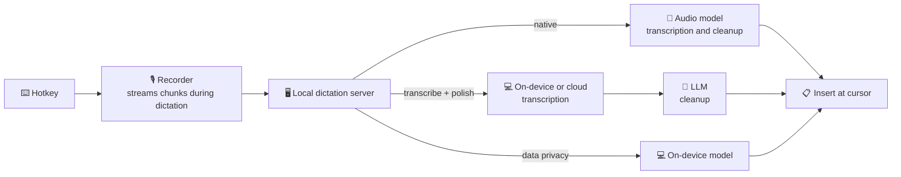

<p align="center">
  
</p>

<h1 align="center">SpeakMore</h1>

<p align="center">
  <b>Speak more. Type less.</b><br>
  Free, open-source voice dictation for macOS and Windows.<br>
  Works with leading AI models, or entirely on device.<br>
  <a href="https://speakmore.zephyrxiang.com">speakmore.zephyrxiang.com</a>
</p>

<p align="center">
  
  
  
  <a href="LICENSE"></a>
</p>

<p align="center">
  <a href="README.md">简体中文</a> · <b>English</b>
</p>

<p align="center">
  
</p>

<picture>
  <source media="(prefers-color-scheme: dark)" srcset="https://media.speakmore.zephyrxiang.com/readme/home-dark.en.d337323a.webp" />
  
</picture>

- Press the hotkey to start dictating; press it again to insert the text at the cursor.
- Filler words, repetitions and self-corrections are removed (Native and Transcribe + Polish modes).
- Punctuation is added; longer passages are split into paragraphs and lists.

## Five freedoms

- 🧩 **[Model freedom](#-model-freedom)**: 29 models, plus OpenAI-compatible services.
- 🔀 **[Mode freedom](#-mode-freedom)**: three recognition modes; recommended setups in one click.
- 💻 **[Hardware freedom](#-hardware-freedom)**: Mac and Windows; on-device models on Metal, Vulkan or the CPU.
- 🔒 **[Privacy freedom](#-privacy-freedom)**: Data Privacy mode uploads nothing; no API key or account.
- 💸 **[Cost freedom](#-cost-freedom)**: free software; recommended setups cost $0–5.29 a month at 100 dictations a day.

## 🚀 Installation

<p align="center">
  <a href="https://dl.zephyrxiang.com/speakmore/v0.9.4/Utterly-arm64.dmg"></a>
  <a href="https://dl.zephyrxiang.com/speakmore/v0.9.4/Utterly-x64.dmg"></a>
  <a href="https://dl.zephyrxiang.com/speakmore/v0.9.4/Utterly-Setup-x64.exe"></a>
</p>

**macOS**

- Requires macOS 12 or later.
- Open the dmg and drag SpeakMore into Applications.
- Signed with a Developer ID and notarized by Apple.

**Windows**

- Requires Windows 10 (1809 or later) or Windows 11, 64-bit.
- Run the installer; if "Windows protected your PC" appears, select **More info**, then **Run anyway**.
- Installs per user, without administrator rights.
- No network connection is needed during installation.

**Terminal installation** (includes the `speakmore` command-line tool)

```bash
# macOS
curl -fsSL https://dl.zephyrxiang.com/speakmore/install.sh | bash
```

```powershell
# Windows (PowerShell)
irm https://dl.zephyrxiang.com/speakmore/install.ps1 | iex
```

- Append `.sha256` to any download link to obtain its checksum.

<details>
<summary><b>Installer and terminal installation compared</b></summary>

- The installer provides a standalone app; macOS permissions are granted to SpeakMore itself, and it can open at login.
- The terminal installation on macOS runs from the terminal; permissions are granted to that terminal.
- On Windows, both methods install the same files into `%USERPROFILE%\.speakmore` and add a Start menu entry.
- Both share settings, history and the `speakmore` command; run only one at a time.

</details>

## 🎙️ Usage

1. Place the cursor in any text field and press **Right Option** (**Right Alt** on Windows).
2. Dictate. The bar at the bottom of the screen follows the input level.
3. Press the hotkey again to insert the text at the cursor, or press `esc` to discard the dictation.

- SpeakMore resides in the menu bar (the notification area on Windows).
- The main window provides statistics, history, models and settings.

### Onboarding

- On first launch, an onboarding flow guides the configuration.
- Every step supports going back and forward, and can be skipped and completed later in the main window.
- Data Privacy mode requires no API key.

<table>
  <tr>
    <td width="50%"></td>
    <td width="50%"></td>
  </tr>
  <tr>
    <td align="center"><sub><b>1</b> · Select a recognition mode</sub></td>
    <td align="center"><sub><b>2</b> · Configure an API key (optional)</sub></td>
  </tr>
  <tr>
    <td></td>
    <td></td>
  </tr>
  <tr>
    <td align="center"><sub><b>3</b> · Download an on-device model in the background</sub></td>
    <td align="center"><sub><b>4</b> · Grant system permissions</sub></td>
  </tr>
  <tr>
    <td></td>
    <td></td>
  </tr>
  <tr>
    <td align="center"><sub><b>5</b> · Test the microphone</sub></td>
    <td align="center"><sub><b>6</b> · Test the hotkey</sub></td>
  </tr>
  <tr>
    <td></td>
    <td></td>
  </tr>
  <tr>
    <td align="center"><sub><b>7</b> · Dictation test</sub></td>
    <td align="center"><sub><b>8</b> · Setup complete</sub></td>
  </tr>
</table>

## 🧩 Model freedom

<picture>
  <source media="(prefers-color-scheme: dark)" srcset="https://media.speakmore.zephyrxiang.com/readme/vendors-dark.en.51093b18.webp" />
  
</picture>

<sub>All names and logos are the property of their respective owners and are shown solely to indicate supported services.</sub>

The **Models** page lists every model by role:

- **7 native models**: audio in, text out.
- **10 transcription models**: 4 on-device, 6 cloud.
- **12 polishing models**: Qwen, DeepSeek, Kimi, Zhipu, MiniMax, and custom services.
- List prices and measured scores for each model.
- A model offered by several platforms appears as one row, with a choice of channel.

**API keys** are managed per platform:

- One Alibaba Cloud Bailian key provides access to 14 models.
- Official DeepSeek, Kimi, Zhipu, MiniMax, Gemini and OpenAI keys are supported directly.
- OpenAI-compatible services connect with an endpoint address and a key.

<table>
  <tr>
    <td width="50%"></td>
    <td width="50%"></td>
  </tr>
  <tr>
    <td align="center"><sub>All models and channels</sub></td>
    <td align="center"><sub>Keys managed per platform</sub></td>
  </tr>
</table>

## 🔀 Mode freedom

- Three recognition modes of equal standing.
- Each mode keeps its own model configuration; switching requires no reconfiguration.

| Mode | Pipeline | Data uploaded | API key |
| --- | --- | --- | --- |
| ✨ **Native** | Audio → audio model → text | Recording | Required |
| 🪄 **Transcribe + Polish** | Audio → transcription → LLM | Text only, if on device | Required |
| 🛡️ **Data Privacy** | Audio → on-device model → text | None | None |

<table>
  <tr>
    <td width="50%"></td>
    <td width="50%"></td>
  </tr>
  <tr>
    <td align="center"><sub>Mode selection on the home window</sub></td>
    <td align="center"><sub>Recommended setups</sub></td>
  </tr>
</table>

**Recommended setups**:

- Package a complete pipeline, enabled in one click.
- Can be checked before they are enabled.
- Missing keys and on-device models are completed in place.

| Setup | Pipeline | Monthly cost |
| --- | --- | --- |
| On-device + DeepSeek | Qwen3-ASR 0.6B (on device) → DeepSeek V4.1 Flash | **$0.39** |
| Bailian Cloud | Qwen3 ASR Flash → DeepSeek V4.1 Flash | $3.02 |
| Gemini Native | Gemini 3.6 Flash | $5.29 |
| Fully On-device | Qwen3-ASR 0.6B (on device) | **$0** |

<sub>Monthly cost basis: 100 dictations a day for 30 days; 26 seconds per dictation (the average of 97 real dictations); estimated at vendor list prices. Intel Macs use the CPU build of SenseVoice Small.</sub>

## 💻 Hardware freedom

- The same on-device models run on every supported device.
- An available graphics card is used first.
- Without a usable graphics card, SpeakMore falls back to the CPU automatically.

| Device | Acceleration | Model | Per dictation |
| --- | --- | --- | --- |
| Mac, Apple silicon | Metal | Qwen3-ASR 0.6B | **231 ms** |
| Windows + GPU | Vulkan | Qwen3-ASR 0.6B | **240 ms** |
| Mac, Apple silicon | CPU | SenseVoice Small | 145 ms |
| Windows (i5-13400F) | CPU | SenseVoice Small | 463 ms |

<sub>Median transcription time across 97 real dictations; Windows GPU: RTX 4060 Ti. Vulkan supports NVIDIA, AMD and Intel graphics.</sub>


## 🔒 Privacy freedom

- **No uploads in Data Privacy mode**: speech is transcribed by an on-device model.
- **No API key or account required.**
- **One-click download**: on-device models are served from SpeakMore's mirror in mainland China.
- **Automatic fallback**: Hugging Face is used if the mirror is unavailable.
- **Integrity check**: every download is verified against SHA-256.
- **No intermediary servers**: audio or text goes directly to the selected vendor with the user's own key.
- **No analytics.**
- **Encrypted keys**: protected by the macOS Keychain or Windows DPAPI.
- **Local data**: history and recordings remain on the local machine.

<picture>
  <source media="(prefers-color-scheme: dark)" srcset="https://media.speakmore.zephyrxiang.com/readme/download-speed-dark.en.8b4db543.webp" />
  
</picture>

## 💸 Cost freedom

- SpeakMore is free.
- Model usage is billed directly by each vendor, according to actual use.
- The home window itemizes all spending.

Comparison with every Typeless plan (heavy use, 100 dictations a day):

<table>
  <tr>
    <th>Product</th><th>Plan</th><th>Monthly</th><th>Annual</th><th>Words</th><th>Voice data</th><th>Sign-up</th>
  </tr>
  <tr>
    <td rowspan="4">Typeless</td><td>Free</td><td>$0</td><td>$0</td><td>Capped</td><td>Typeless<sup>1</sup></td><td>Yes</td>
  </tr>
  <tr>
    <td>Pro, annual</td><td>$12</td><td>$144</td><td>Unlimited</td><td>Typeless<sup>1</sup></td><td>Yes</td>
  </tr>
  <tr>
    <td>Pro, monthly</td><td>$30</td><td>$360</td><td>Unlimited</td><td>Typeless<sup>1</sup></td><td>Yes</td>
  </tr>
  <tr>
    <td>Enterprise</td><td>Quote</td><td>Quote</td><td>Unlimited</td><td>Typeless<sup>1</sup></td><td>Yes</td>
  </tr>
  <tr>
    <td rowspan="4"><b>SpeakMore</b></td><td><b>Fully On-device</b></td><td><b>$0</b></td><td><b>$0</b></td><td>Unlimited</td><td><b>On device</b></td><td><b>No</b></td>
  </tr>
  <tr>
    <td><b>On-device + DeepSeek</b></td><td><b>$0.39</b></td><td><b>$4.70</b></td><td>Unlimited</td><td>DeepSeek</td><td><b>No</b></td>
  </tr>
  <tr>
    <td><b>Bailian Cloud</b></td><td><b>$3.02</b></td><td><b>$36</b></td><td>Unlimited</td><td>Alibaba Cloud</td><td><b>No</b></td>
  </tr>
  <tr>
    <td><b>Gemini Native</b></td><td><b>$5.29</b></td><td><b>$63</b></td><td>Unlimited</td><td>Google</td><td><b>No</b></td>
  </tr>
</table>

<sub>With On-device + DeepSeek, only the transcribed text is sent to DeepSeek. Typeless prices from <a href="https://www.typeless.com/pricing">typeless.com/pricing</a> (2026-10-17). SpeakMore figures are estimates on the basis of the setups table above; usage within Gemini's free tier incurs no cost.<br>
<sup>1</sup> Sent to Typeless servers together with the active application, window title and on-screen text; see the <a href="targets/typeless/docs/06-context-capture-and-privacy.md">reverse-engineering notes</a> (Chinese).</sub>

## 📊 Benchmarks

- **Prompt**: tuned on 60 real recordings, each compared with the Typeless output for the same audio.
- **Samples**: 97 real dictations, 42.5 minutes in total, covering Chinese, mixed Chinese–English and English.
- **Scoring**: 0–5 against the Native mode output, using a fixed rubric.

<details>
<summary><b>On-device transcription: Apple silicon and Windows</b></summary>

| Model | Score | Size | Mac | Windows |
| --- | --- | --- | --- | --- |
| `qwen3-asr-0.6b-q8` (default) | 4.14–4.16 | 850 MB | Metal 231 ms | Vulkan 240 ms |
| `sensevoice-small-q8` | 3.94 | 253 MB | Metal 73 ms | Vulkan 107 ms |
| `qwen3-asr-0.6b-int8` | 4.02–4.06 | 987 MB | CPU 1081 ms | CPU 3388 ms |
| `sensevoice-small-int8` | 3.75–3.78 | 237 MB | CPU 145 ms | CPU 463 ms |

- Times are medians per dictation.
- Windows test machine: Core i5-13400F, RTX 4060 Ti.
- Scores by language: Qwen3-ASR 4.32 on Chinese, 4.02 on mixed Chinese–English; SenseVoice 4.38 on Chinese.
- Full results: [Apple silicon](bench/results/asr-round1-2026-10-16.md), [Windows](bench/results/asr-windows-2026-10-17.md) (Chinese).

</details>

<details>
<summary><b>End to end: Transcribe + Polish on Apple silicon</b></summary>

- From hotkey release to text on screen: **1.2–1.75 seconds**.
- Transcription takes under 0.7 seconds; the remainder is the polishing request.
- With prompt caching, one DeepSeek polishing request costs about $0.00004.
- See the [measurements](bench/results/e2e-local-2026-10-16.md) (Chinese).

</details>

- The benchmark harness resides in [`bench/`](bench/README.md); adding a model runs only that model's column.

## ✅ Trust

- **Open source**: MIT-licensed; all code that handles voice data is public.
- **No account**: no registration or sign-in.
- **Single directory**: data, settings, keys, models and logs are stored in `~/.speakmore` (`%USERPROFILE%\.speakmore` on Windows).
- **Complete removal**: `speakmore uninstall` deletes everything.
- **Signed and notarized**: the Mac app carries a Developer ID signature and Apple notarization.
- **Verifiable**: every package has a SHA-256 checksum.
- **Reverse-engineered**: the Typeless client is documented in [18 notes](targets/typeless/docs/00-overview.md) (Chinese).
- **Independently implemented**: SpeakMore was written from scratch and contains no Typeless code or keys.

## 🧑‍💻 For developers

- **CLI and app parity**: switch modes and models, manage and check keys, download models, query history and spending.
- **JSON output**: `status`, `history` and `usage` support `--json`.
- **Plug-in architecture**: each vendor is a strategy behind a common interface.
- **Unified I/O**: audio is normalized to 16 kHz mono; every transcriber returns `{ text }`.
- **Cross-platform development**: [`scripts/dev/win-*.sh`](scripts/dev) synchronize the working tree to a Windows machine over SSH, run tests remotely, restart the app from source with a debugging port, and capture the desktop.
- **Automated tests**: 939 unit tests and 19 installation tests.
- **Quality gates**: Biome linting plus checks on interface sizing, typography and copy; `npm run check` runs them all.

```bash
git clone https://github.com/zephyr4123/speakmore.git && cd speakmore
npm install
npm start          # equivalent to the speakmore command
npm run check      # lint and all tests
```



- Project layout, packaging and release process: [development notes](docs/development.md) (Chinese).
- Mapping to the original, model selection and prompt tuning: [implementation notes](docs/implementation-notes.md) (Chinese).

## 📚 Reference

<details>
<summary><b>⌨️ Commands</b></summary>

| Command | Description |
| --- | --- |
| `speakmore` | Start; shows status if already running |
| `speakmore stop` / `restart` | Stop / restart |
| `speakmore status [--json]` | Running state, keys, permissions and usage |
| `speakmore update` | Update to the latest version |
| `speakmore history [-n count] [--json]` | History, newest first |
| `speakmore usage [--json]` | Spending, tokens and response times per model |
| `speakmore mode [native\|local\|private]` | Show or switch the recognition mode |
| `speakmore model [<provider>[/<model>]]` | Show or switch the native model |
| `speakmore transcriber [<model>]` | Show or switch the transcription model |
| `speakmore transcriber download <model>` | Download an on-device model |
| `speakmore transcriber cancel <model>` | Cancel a download |
| `speakmore transcriber delete <model>` | Delete an on-device model |
| `speakmore polish [<provider>/<model>]` | Show or switch the polishing model |
| `speakmore model check` | Check the native model |
| `speakmore transcriber check` | Check the transcription model |
| `speakmore polish check` | Check the polishing model |
| `speakmore key [<provider>]` | Replace a key; accepts piped input |
| `speakmore key --forget [<provider>]` | Delete a stored key |
| `speakmore config` / `config set` / `config unset` | Show settings / set a value / restore the default |
| `speakmore theme [name]` | Show or switch the theme |
| `speakmore settings` | Open settings |
| `speakmore logs [-n lines] [-f]` | Show logs |
| `speakmore uninstall [--keep-data]` | Uninstall, after confirmation |

- `update` also updates SpeakMore.app; settings, keys, history and recordings are preserved.
- `check` commands send a minimal request (for on-device models, a sentence read by the system voice) to check connectivity and response time.
- `local` is Transcribe + Polish; `private` is Data Privacy.
- Native providers: `gemini` / `openai` / `bailian`.
- Polishing providers: `deepseek` / `bailian` / `moonshot` / `zhipu` / `minimax` / `custom`; a custom service also takes `--url <url>`, and optionally `--params '<JSON>'` for extra request parameters.
- Piped input example: `pbpaste | speakmore key` (Windows: `Get-Clipboard | speakmore key`).

</details>

<details>
<summary><b>⚙️ Settings</b></summary>

| Name | Default | Description |
| --- | --- | --- |
| `hotkey` | `right_option` | Hotkey; `right_alt` on Windows |
| `mode` | `native` | Recognition mode: `native` / `local` / `private` |
| `model` | `gemini/gemini-3.6-flash` | Native model, as `provider/model` |
| `thinking` | `MINIMAL` | Gemini thinking level |
| `transcriber` | `qwen3-asr-0.6b-q8` | Transcription model for Transcribe + Polish |
| `privateTranscriber` | `qwen3-asr-0.6b-q8` | On-device model for Data Privacy |
| `polish` | `deepseek/deepseek-flash` | Polishing model, as `provider/model` |
| `customUrl` | empty | OpenAI-compatible endpoint |
| `customParams` | empty | Extra request parameters for the custom service, as a JSON object |
| `modelSource` | `cn` | Download source: `cn` / `original` |
| `acceleration` | `auto` | Acceleration: `auto` / `cpu` |
| `barHint` | `on` | Hint line above the voice bar: `on` / `off` |
| `theme` | `ink` | Theme: `ink` / `cinnabar` / `indigo` |
| `language` | `system` | Language: `system` / `en` / `zh-CN` |

- Settings are stored in `~/.speakmore/settings.json`.
- Hotkey values: macOS `right_option` / `right_command` / `right_control` / `fn`; Windows `right_alt` / `right_ctrl`.
- Gemini thinking levels: `MINIMAL` / `LOW` / `MEDIUM` / `HIGH`.
- A self-hosted polishing model is written as `custom/<model>`, e.g. at `http://127.0.0.1:11434/v1`.
- Extra parameters a custom service needs go in `customParams`, e.g. `{"reasoning_effort": "minimal"}`. They are sent with both checks and polishing; `model`, `messages`, and `stream` cannot be overridden. When capping a reasoning model's output, leave room for its thinking (e.g. `{"max_completion_tokens": 4096}`), or long passages get cut off.
- In Windows PowerShell, put a backslash before each double quote in `--params`: `--params '{\"reasoning_effort\": \"minimal\"}'`.
- Switching through the app or `speakmore mode`, `model`, `transcriber` and `polish` is checked first and takes effect immediately.
- `config set` writes values directly, without checks.
- Temporary overrides: set environment variables such as `SPEAKMORE_HOTKEY`, `SPEAKMORE_MODE` and `SPEAKMORE_MODEL` at startup.
- Keys in environment variables take precedence over stored keys: `GEMINI_API_KEY`, `OPENAI_API_KEY`, `DEEPSEEK_API_KEY`, `BAILIAN_API_KEY`, `MOONSHOT_API_KEY` (Kimi), `ZHIPU_API_KEY`, `MINIMAX_API_KEY`, `SPEAKMORE_CUSTOM_API_KEY`.

</details>

<details>
<summary><b>💰 Cost accounting</b></summary>

- Every model call is recorded with its tokens (including audio and thinking), model, cost and latency.
- The home window breaks down today, this month and all time by model.
- On-device transcription appears as a separate, free entry.
- `speakmore usage` provides further detail.
- Costs are estimates in US dollars at each vendor's list price; platforms priced in yuan are converted at 6.71.
- Gemini's prompt cache bills repeated prompt content at one tenth of the standard price; the cache is created as soon as dictation starts.

</details>

<details>
<summary><b>🔐 Permissions</b></summary>

| macOS permission | Purpose |
| --- | --- |
| Microphone | Recording |
| Input Monitoring | Detecting the hotkey, and only that key |
| Accessibility | Inserting text with a simulated ⌘V; responding to `esc` |

- The app requests these permissions during onboarding.
- With the terminal installation, permissions are granted to the terminal that runs SpeakMore.
- On Windows, only microphone access is required (Settings › Privacy & security › Microphone).

</details>

<details>
<summary><b>🗂️ File locations</b></summary>

| File | Description |
| --- | --- |
| `settings.json` | Settings |
| `<vendor>-key.bin` | Encrypted keys, one per vendor |
| `data/history.db` | History and spending records |
| `data/Recordings/` | Recordings |
| `logs/main.log` | Logs |
| `models/` | On-device models |
| `bin/`, `app/`, `runtime/` | Program files of the terminal installation |

- All files are stored in `~/.speakmore/` (`%USERPROFILE%\.speakmore\` on Windows) and are readable only by the current user.
- The key decryption secret is held in the Keychain (bound to the account by DPAPI on Windows); a copied key file cannot be decrypted.
- Logs contain lengths, timings and usage only; dictated content and keys are never logged.
- On-device models are downloaded on request and verified against SHA-256.
- Outside this directory: the Keychain entry, granted system permissions, and SpeakMore in Applications.
- On Windows, also the Start menu shortcut, a Path entry and the open-at-login entry.

</details>

<details>
<summary><b>🩺 Troubleshooting</b></summary>

| Symptom | Resolution |
| --- | --- |
| A key shows "not verified" | Run `speakmore status` once online |
| A check fails although the key is correct | Run `speakmore model check` to see the response |
| The hotkey has no effect | Run `speakmore status`, then `speakmore restart` |
| A command times out | Run `speakmore stop`, then `speakmore` |
| No menu bar icon | Run `speakmore settings` |

- "Not verified" means the vendor was unreachable at startup and the stored key is in use.
- A failed check is usually caused by an incorrect model name or thinking level; `speakmore config unset model` restores the default.
- On MacBooks with a notch, surplus menu bar icons are hidden behind it; hold ⌘ and drag some icons out of the menu bar.

</details>

<details>
<summary><b>🔄 Updating and uninstalling</b></summary>

- **Update**: `speakmore update` updates both the terminal installation and SpeakMore.app, then reopens whichever was running.
- **Update, app only**: download the new dmg and install it over the existing copy.
- **Preserved on update**: settings, keys, history and recordings.
- **Uninstall**: `speakmore uninstall` stops SpeakMore and removes the entire directory, the command and the Keychain entry.
- **Uninstall on Windows**: also removes the Path entry, Start menu shortcut and open-at-login entry.
- **Keep data**: add `--keep-data` to preserve settings, keys, history and recordings.
- **Uninstall, app only**: quit it from the menu bar and move it to the Trash.

</details>

## License

- [MIT](LICENSE).
- Files under `.claude/skills/` are from [REA](https://github.com/morluto/rea) and are covered by its own MIT license.
- The name pays tribute to Typeless. SpeakMore is an independent implementation based on reverse-engineering notes and is not affiliated with Typeless.
