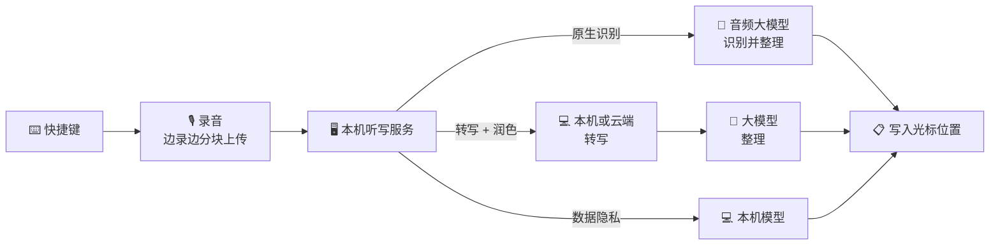

<p align="center">
  
</p>

<h1 align="center">SpeakMore</h1>

<p align="center">
  <b>说话，别打字。</b><br>
  开源、免费的语音输入工具，支持 macOS 与 Windows。<br>
  兼容主流大模型，亦可完全在本机运行。<br>
  <a href="https://speakmore.zephyrxiang.com/?lang=zh-CN">speakmore.zephyrxiang.com</a>
</p>

<p align="center">
  
  
  
  <a href="LICENSE"></a>
</p>

<p align="center">
  <b>简体中文</b> · <a href="README.en.md">English</a>
</p>

<p align="center">
  
</p>

<picture>
  <source media="(prefers-color-scheme: dark)" srcset="https://media.speakmore.zephyrxiang.com/readme/home-dark.zh-CN.ded4c77a.webp?v=4" />
  
</picture>

- 按下快捷键开始口述，再次按下结束，文字写入当前光标位置。
- 自动去除语气词、重复与改口内容（原生识别、转写 + 润色方式）。
- 自动补全标点，较长内容分段、分条。

## 五项自由

- 🧩 **[模型自由](#-模型自由)**：29 个模型，并支持 OpenAI 兼容服务。
- 🔀 **[方式自由](#-方式自由)**：三种识别方式并列可选，推荐组合一键启用。
- 💻 **[硬件自由](#-硬件自由)**：Mac 与 Windows 通用，本机模型经 Metal、Vulkan 或 CPU 运行。
- 🔒 **[隐私自由](#-隐私自由)**：数据隐私方式不上传数据，无需密钥与账号。
- 💸 **[费用自由](#-费用自由)**：软件免费；按每日 100 次计，推荐组合月成本 ¥0–35。

## 🚀 安装

<p align="center">
  <a href="https://dl.zephyrxiang.com/speakmore/v0.9.4/SpeakMore-arm64.dmg"></a>
  <a href="https://dl.zephyrxiang.com/speakmore/v0.9.4/SpeakMore-x64.dmg"></a>
  <a href="https://dl.zephyrxiang.com/speakmore/v0.9.4/SpeakMore-Setup-x64.exe"></a>
</p>

**macOS**

- 系统要求：macOS 12 及以上。
- 打开 dmg，将 SpeakMore 拖入"应用程序"。
- 安装包已使用 Developer ID 签名，并通过 Apple 公证。

**Windows**

- 系统要求：Windows 10（1809 及以上）或 Windows 11，64 位。
- 运行安装程序；如出现"Windows 已保护你的电脑"，依次点击"更多信息""仍要运行"。
- 仅为当前账户安装，无需管理员权限。
- 安装过程无需联网。

**终端安装**（附带 `speakmore` 命令行工具）

```bash
# macOS
curl -fsSL https://dl.zephyrxiang.com/speakmore/install.sh | bash
```

```powershell
# Windows（PowerShell）
irm https://dl.zephyrxiang.com/speakmore/install.ps1 | iex
```

- 下载链接末尾附加 `.sha256`，可获取对应文件的校验值。

<details>
<summary><b>安装包与终端安装的区别</b></summary>

- 安装包为独立应用：macOS 权限授予 SpeakMore 本身，支持开机自启。
- 终端安装在 macOS 上由终端启动，权限授予所用终端。
- Windows 下两种方式的安装内容相同，均位于 `%USERPROFILE%\.speakmore`，并添加开始菜单项。
- 两种方式共用设置、历史记录与 `speakmore` 命令，同一时间运行其一即可。

</details>

## 🎙️ 使用

1. 将光标置于任意输入框，按下**右 Option**（Windows 为**右 Alt**）。
2. 开始口述，屏幕底部的悬浮条随音量变化。
3. 再次按下快捷键，文字写入光标位置；按 `esc` 取消本次口述。

- SpeakMore 常驻菜单栏（Windows 为任务栏通知区域）。
- 主窗口提供统计、历史记录、模型与设置。

### 首次引导

- 首次启动时由引导完成配置。
- 各步骤均可前进、后退，也可跳过，稍后在主窗口中补充。
- 数据隐私方式无需任何密钥。

<table>
  <tr>
    <td width="50%"></td>
    <td width="50%"></td>
  </tr>
  <tr>
    <td align="center"><sub><b>1</b> · 选择识别方式</sub></td>
    <td align="center"><sub><b>2</b> · 配置密钥（可跳过）</sub></td>
  </tr>
  <tr>
    <td></td>
    <td></td>
  </tr>
  <tr>
    <td align="center"><sub><b>3</b> · 后台下载本机模型</sub></td>
    <td align="center"><sub><b>4</b> · 授予系统权限</sub></td>
  </tr>
  <tr>
    <td></td>
    <td></td>
  </tr>
  <tr>
    <td align="center"><sub><b>5</b> · 测试麦克风</sub></td>
    <td align="center"><sub><b>6</b> · 测试快捷键</sub></td>
  </tr>
  <tr>
    <td></td>
    <td></td>
  </tr>
  <tr>
    <td align="center"><sub><b>7</b> · 口述测试</sub></td>
    <td align="center"><sub><b>8</b> · 完成配置</sub></td>
  </tr>
</table>

## 🧩 模型自由

<picture>
  <source media="(prefers-color-scheme: dark)" srcset="https://media.speakmore.zephyrxiang.com/readme/vendors-dark.zh-CN.4bf2ba43.webp" />
  
</picture>

<sub>上述名称与标志归各自权利人所有，仅用于说明 SpeakMore 支持对接的服务。</sub>

**模型页**按用途列出全部模型：

- **原生识别 7 个**：音频输入，文字输出。
- **转写 10 个**：本机 4 个，云端 6 个。
- **润色 12 个**：通义千问、DeepSeek、Kimi、智谱、MiniMax 与自定义服务。
- 每个模型标注官方价格与实测得分。
- 同一模型由多个平台提供时合并为一行，可选渠道。

**密钥**按平台管理：

- 一把阿里云百炼密钥可调用 14 个模型。
- DeepSeek、Kimi、智谱、MiniMax、Gemini、OpenAI 的官方密钥均可直接使用。
- OpenAI 兼容服务填写地址与密钥即可接入。

<table>
  <tr>
    <td width="50%"></td>
    <td width="50%"></td>
  </tr>
  <tr>
    <td align="center"><sub>全部模型与渠道</sub></td>
    <td align="center"><sub>按平台管理密钥</sub></td>
  </tr>
</table>

## 🔀 方式自由

- 三种识别方式并列可选。
- 各方式独立保存模型配置，切换时无需重新设置。

| 方式 | 处理流程 | 上传内容 | 密钥 |
| --- | --- | --- | --- |
| ✨ **原生识别** | 录音 → 音频大模型 → 成稿 | 录音 | 需要 |
| 🪄 **转写 + 润色** | 录音 → 转写 → 大模型润色 | 本机转写时仅文字 | 需要 |
| 🛡️ **数据隐私** | 录音 → 本机模型 → 文字 | 无 | 不需要 |

<table>
  <tr>
    <td width="50%"></td>
    <td width="50%"></td>
  </tr>
  <tr>
    <td align="center"><sub>首页切换识别方式</sub></td>
    <td align="center"><sub>推荐组合一键启用</sub></td>
  </tr>
</table>

**推荐组合**：

- 将完整路线打包，一键启用。
- 支持先检测、后启用。
- 缺少的密钥与本机模型可在原处补齐。

| 组合 | 路线 | 月成本 |
| --- | --- | --- |
| 本机转写 + DeepSeek | Qwen3-ASR 0.6B（本机）→ DeepSeek V4.1 Flash | **¥2.63** |
| 百炼全云端 | Qwen3 ASR Flash → DeepSeek V4.1 Flash | ¥20.24 |
| Gemini 原生识别 | Gemini 3.6 Flash | ¥35.49 |
| 纯本机 | Qwen3-ASR 0.6B（本机） | **¥0** |

<sub>月成本口径：每日 100 次、每月 30 天；单次按 26 秒计（97 条真实口述的平均值）；按各厂商官方价格估算，美元按 6.71 折算。Intel Mac 改用 CPU 版 SenseVoice Small。</sub>

## 💻 硬件自由

- 同一本机模型适用于全部受支持的设备。
- 有可用显卡时优先使用显卡。
- 无显卡或显卡不可用时，自动回退至 CPU。

| 设备 | 加速 | 模型 | 单条耗时 |
| --- | --- | --- | --- |
| Apple 芯片 Mac | Metal | Qwen3-ASR 0.6B | **231 毫秒** |
| Windows + 显卡 | Vulkan | Qwen3-ASR 0.6B | **240 毫秒** |
| Apple 芯片 Mac | CPU | SenseVoice Small | 145 毫秒 |
| Windows（i5-13400F） | CPU | SenseVoice Small | 463 毫秒 |

<sub>单条耗时为 97 条真实口述的转写耗时中位数；Windows 显卡为 RTX 4060 Ti。Vulkan 支持 NVIDIA、AMD 与 Intel 显卡。</sub>


## 🔒 隐私自由

- **数据隐私方式不上传任何数据**：语音由本机模型转写为文字。
- **无需密钥与账号**。
- **国内源一键下载**：默认经 SpeakMore 国内源下载本机模型。
- **自动切换下载源**：国内源不可用时改用 Hugging Face。
- **完整性校验**：下载完成后校验 SHA-256。
- **无中转服务器**：录音或文字以用户自有密钥直接发送至所选厂商。
- **不采集统计数据**。
- **密钥加密存储**：macOS 使用钥匙串，Windows 使用 DPAPI。
- **数据留存本机**：历史记录与录音仅保存在本机。

<picture>
  <source media="(prefers-color-scheme: dark)" srcset="https://media.speakmore.zephyrxiang.com/readme/download-speed-dark.zh-CN.170a9ced.webp" />
  
</picture>

## 💸 费用自由

- SpeakMore 本身免费。
- 模型费用按实际用量，直接结算给厂商。
- 首页逐项统计花费。

与 Typeless 各档套餐对比（重度使用，每日 100 次）：

<table>
  <tr>
    <th>产品</th><th>方案</th><th>月费</th><th>年费</th><th>字数</th><th>数据去向</th><th>账号</th>
  </tr>
  <tr>
    <td rowspan="4">Typeless</td><td>免费版</td><td>¥0</td><td>¥0</td><td>每周限额</td><td>Typeless 服务器<sup>1</sup></td><td>需注册</td>
  </tr>
  <tr>
    <td>Pro 年付</td><td>¥81</td><td>¥966</td><td>不限</td><td>Typeless 服务器<sup>1</sup></td><td>需注册</td>
  </tr>
  <tr>
    <td>Pro 月付</td><td>¥201</td><td>¥2,416</td><td>不限</td><td>Typeless 服务器<sup>1</sup></td><td>需注册</td>
  </tr>
  <tr>
    <td>企业版</td><td>需询价</td><td>需询价</td><td>不限</td><td>Typeless 服务器<sup>1</sup></td><td>需注册</td>
  </tr>
  <tr>
    <td rowspan="4"><b>SpeakMore</b></td><td><b>纯本机</b></td><td><b>¥0</b></td><td><b>¥0</b></td><td>不限</td><td><b>本机</b></td><td><b>无需</b></td>
  </tr>
  <tr>
    <td><b>本机转写 + DeepSeek</b></td><td><b>¥2.63</b></td><td><b>¥32</b></td><td>不限</td><td>仅文字 → DeepSeek</td><td><b>无需</b></td>
  </tr>
  <tr>
    <td><b>百炼全云端</b></td><td><b>¥20.24</b></td><td><b>¥243</b></td><td>不限</td><td>阿里云百炼</td><td><b>无需</b></td>
  </tr>
  <tr>
    <td><b>Gemini 原生识别</b></td><td><b>¥35.49</b></td><td><b>¥426</b></td><td>不限</td><td>Google</td><td><b>无需</b></td>
  </tr>
</table>

<sub>Typeless 价格取自 <a href="https://www.typeless.com/pricing">typeless.com/pricing</a>（2026-10-17），美元按 6.71 折算人民币。SpeakMore 为估算值，口径同上文推荐组合；使用 Gemini 免费额度时不产生费用。<br>
<sup>1</sup> 同时上传当前应用、窗口标题与屏幕文字，详见<a href="targets/typeless/docs/06-context-capture-and-privacy.md">逆向笔记</a>。</sub>

## 📊 评测

- **提示词**：基于 60 条真实录音调优，逐条与 Typeless 对同一录音的输出比对。
- **样本**：97 条真实口述，共 42.5 分钟，涵盖中文、中英混合与英文。
- **评分**：以原生识别的输出为参照，按统一标准评 0–5 分。

<details>
<summary><b>本机转写：Apple 芯片与 Windows</b></summary>

| 模型 | 得分 | 体积 | Mac | Windows |
| --- | --- | --- | --- | --- |
| `qwen3-asr-0.6b-q8`（默认） | 4.14–4.16 | 850 MB | Metal 231 毫秒 | Vulkan 240 毫秒 |
| `sensevoice-small-q8` | 3.94 | 253 MB | Metal 73 毫秒 | Vulkan 107 毫秒 |
| `qwen3-asr-0.6b-int8` | 4.02–4.06 | 987 MB | CPU 1081 毫秒 | CPU 3388 毫秒 |
| `sensevoice-small-int8` | 3.75–3.78 | 237 MB | CPU 145 毫秒 | CPU 463 毫秒 |

- 耗时为单条口述的中位数。
- Windows 测试机：Core i5-13400F，RTX 4060 Ti。
- 分语言得分：Qwen3-ASR 中文 4.32、中英混合 4.02；SenseVoice 中文 4.38。
- 完整数据：[Apple 芯片](bench/results/asr-round1-2026-10-16.md)、[Windows](bench/results/asr-windows-2026-10-17.md)。

</details>

<details>
<summary><b>端到端：Apple 芯片上的转写 + 润色</b></summary>

- 自松开快捷键至文字上屏：**1.2–1.75 秒**。
- 其中转写不足 0.7 秒，其余为润色请求耗时。
- 借助提示词缓存，DeepSeek 单次润色费用约 $0.00004。
- 详见[实测记录](bench/results/e2e-local-2026-10-16.md)。

</details>

- 评测框架位于 [`bench/`](bench/README.md)，新增模型时仅运行对应的一列。

## ✅ 可信

- **开源**：MIT 许可，语音处理相关代码全部公开。
- **无需账号**：无注册与登录流程。
- **单一目录**：数据、设置、密钥、模型与日志统一存放于 `~/.speakmore`（Windows 为 `%USERPROFILE%\.speakmore`）。
- **一键清除**：执行 `speakmore uninstall` 删除全部内容。
- **签名公证**：Mac 版经 Developer ID 签名与 Apple 公证。
- **可校验**：全部安装包提供 SHA-256 校验值。
- **逆向分析**：Typeless 客户端的拆解整理为 [18 篇笔记](targets/typeless/docs/00-overview.md)。
- **独立实现**：SpeakMore 参照其交互从零实现，不含 Typeless 的任何代码与密钥。

## 🧑‍💻 开发者

- **命令行与 App 功能对等**：切换方式与模型、管理与检测密钥、下载模型、查询历史与花费。
- **JSON 输出**：`status`、`history`、`usage` 支持 `--json`。
- **插件化架构**：各厂商以策略模式实现统一接口。
- **统一输入输出**：录音统一为 16 kHz 单声道，转写结果统一为 `{ text }`。
- **跨平台开发**：[`scripts/dev/win-*.sh`](scripts/dev) 经 SSH 同步工作区至 Windows 机器，在远端运行测试、以调试端口从源码重启 App、截取桌面画面。
- **自动化测试**：939 个单元测试与 19 个安装测试。
- **门禁**：Biome 代码检查，界面尺寸、字号与文案规范检查；`npm run check` 一次执行全部检查。

```bash
git clone https://github.com/zephyr4123/speakmore.git && cd speakmore
npm install
npm start          # 等同于 speakmore 命令
npm run check      # 代码检查与全部测试
```



- 目录结构、打包与发布流程：见[开发说明](docs/development.md)。
- 与原版的对应关系、模型选型与提示词调优：见[实现笔记](docs/implementation-notes.md)。

## 📚 参考

<details>
<summary><b>⌨️ 命令</b></summary>

| 命令 | 说明 |
| --- | --- |
| `speakmore` | 启动；已运行时显示状态 |
| `speakmore stop` / `restart` | 停止 / 重启 |
| `speakmore status [--json]` | 运行状态、密钥、权限与用量 |
| `speakmore update` | 升级至最新版本 |
| `speakmore history [-n 条数] [--json]` | 历史记录，按时间倒序 |
| `speakmore usage [--json]` | 花费、token 与响应耗时，按模型分列 |
| `speakmore mode [native\|local\|private]` | 查看或切换识别方式 |
| `speakmore model [<厂商>[/<模型>]]` | 查看或切换原生识别模型 |
| `speakmore transcriber [<模型>]` | 查看或切换转写模型 |
| `speakmore transcriber download <模型>` | 下载本机模型 |
| `speakmore transcriber cancel <模型>` | 取消下载 |
| `speakmore transcriber delete <模型>` | 删除本机模型 |
| `speakmore polish [<厂商>/<模型>]` | 查看或切换润色模型 |
| `speakmore model check` | 检测原生识别模型 |
| `speakmore transcriber check` | 检测转写模型 |
| `speakmore polish check` | 检测润色模型 |
| `speakmore key [<厂商>]` | 更换密钥，支持管道输入 |
| `speakmore key --forget [<厂商>]` | 删除已保存的密钥 |
| `speakmore config` / `config set` / `config unset` | 查看设置 / 修改单项 / 恢复默认值 |
| `speakmore theme [名称]` | 查看或切换主题 |
| `speakmore settings` | 打开设置 |
| `speakmore logs [-n 行数] [-f]` | 查看日志 |
| `speakmore uninstall [--keep-data]` | 卸载（执行前确认） |

- `update` 同时升级 SpeakMore.app，设置、密钥、历史记录与录音保留。
- `check` 类命令发送最小请求（本机模型由系统语音朗读样句），检测连通性与响应速度。
- `local` 为转写 + 润色，`private` 为数据隐私。
- 原生识别厂商：`gemini` / `openai` / `bailian`。
- 润色厂商：`deepseek` / `bailian` / `moonshot` / `zhipu` / `minimax` / `custom`；自定义服务另需 `--url <地址>`，可选 `--params '<JSON>'` 附加请求参数。
- 管道输入示例：`pbpaste | speakmore key`（Windows：`Get-Clipboard | speakmore key`）。

</details>

<details>
<summary><b>⚙️ 设置项</b></summary>

| 名称 | 默认值 | 说明 |
| --- | --- | --- |
| `hotkey` | `right_option` | 快捷键；Windows 默认 `right_alt` |
| `mode` | `native` | 识别方式：`native` / `local` / `private` |
| `model` | `gemini/gemini-3.6-flash` | 原生识别模型，`厂商/模型` |
| `thinking` | `MINIMAL` | Gemini 思考档位 |
| `transcriber` | `qwen3-asr-0.6b-q8` | 转写 + 润色的转写模型 |
| `privateTranscriber` | `qwen3-asr-0.6b-q8` | 数据隐私方式的本机模型 |
| `polish` | `deepseek/deepseek-flash` | 润色模型，`厂商/模型` |
| `customUrl` | 空 | OpenAI 兼容服务地址 |
| `customParams` | 空 | 自定义服务的额外请求参数，JSON 对象 |
| `modelSource` | `cn` | 下载源：`cn` / `original` |
| `acceleration` | `auto` | 加速：`auto` / `cpu` |
| `barHint` | `on` | 悬浮条操作提示：`on` / `off` |
| `theme` | `ink` | 主题：`ink` / `cinnabar` / `indigo` |
| `language` | `system` | 语言：`system` / `en` / `zh-CN` |

- 设置保存于 `~/.speakmore/settings.json`。
- 快捷键可选：macOS `right_option` / `right_command` / `right_control` / `fn`；Windows `right_alt` / `right_ctrl`。
- Gemini 思考档位可选：`MINIMAL` / `LOW` / `MEDIUM` / `HIGH`。
- 自建服务的润色模型写作 `custom/<模型>`，地址示例 `http://127.0.0.1:11434/v1`。
- 自定义服务需要额外参数时写入 `customParams`，例如 `{"reasoning_effort": "minimal"}`；检测与润色请求均附带，`model`、`messages`、`stream` 不可覆盖。推理模型限制输出长度时留足思考的余量（如 `{"max_completion_tokens": 4096}`），否则长段落会被截断。
- Windows PowerShell 中 `--params` 的双引号前需加反斜杠：`--params '{\"reasoning_effort\": \"minimal\"}'`。
- 通过 App 或 `speakmore mode`、`model`、`transcriber`、`polish` 切换时先行检测，立即生效。
- `config set` 直接写入，不做检测。
- 临时覆盖：启动时设置 `SPEAKMORE_HOTKEY`、`SPEAKMORE_MODE`、`SPEAKMORE_MODEL` 等环境变量。
- 环境变量中的密钥优先于已保存的密钥：`GEMINI_API_KEY`、`OPENAI_API_KEY`、`DEEPSEEK_API_KEY`、`BAILIAN_API_KEY`、`MOONSHOT_API_KEY`（Kimi）、`ZHIPU_API_KEY`、`MINIMAX_API_KEY`、`SPEAKMORE_CUSTOM_API_KEY`。

</details>

<details>
<summary><b>💰 花费统计</b></summary>

- 每次模型调用均记录 token（含音频与思考）、模型、花费与耗时。
- 首页按模型分列今日、本月与累计数据。
- 本机转写单列，不计费。
- `speakmore usage` 提供更详细的数据。
- 花费为按各厂商官方价格估算的美元金额；以人民币计价的平台按 6.71 折算。
- Gemini 提示词缓存对重复部分按一成价格计费；开始口述时即预先建立缓存。

</details>

<details>
<summary><b>🔐 系统权限</b></summary>

| macOS 权限 | 用途 |
| --- | --- |
| 麦克风 | 录音 |
| 输入监控 | 监听快捷键，仅限该按键 |
| 辅助功能 | 模拟 ⌘V 写入文字，响应 `esc` |

- App 在首次引导中申请上述权限。
- 终端安装时，权限授予运行 SpeakMore 的终端。
- Windows 仅需麦克风权限（设置 › 隐私和安全性 › 麦克风）。

</details>

<details>
<summary><b>🗂️ 文件位置</b></summary>

| 文件 | 说明 |
| --- | --- |
| `settings.json` | 设置 |
| `<厂商>-key.bin` | 加密后的密钥，每个厂商一份 |
| `data/history.db` | 历史记录与花费记录 |
| `data/Recordings/` | 录音 |
| `logs/main.log` | 日志 |
| `models/` | 本机模型 |
| `bin/`、`app/`、`runtime/` | 终端安装的程序文件 |

- 全部文件位于 `~/.speakmore/`（Windows 为 `%USERPROFILE%\.speakmore\`），仅当前用户可读。
- 密钥的解密密钥保存在钥匙串中（Windows 由 DPAPI 绑定账户），文件复制至他处无法解密。
- 日志仅记录长度、耗时与用量，不记录口述内容与密钥。
- 本机模型按需下载，并校验 SHA-256。
- 目录之外：钥匙串条目、已授予的系统权限、"应用程序"中的 SpeakMore。
- Windows 另有开始菜单快捷方式、Path 条目与开机自启项。

</details>

<details>
<summary><b>🩺 故障排查</b></summary>

| 现象 | 处理方法 |
| --- | --- |
| 密钥显示"未验证" | 联网后执行 `speakmore status` |
| 检测未通过，密钥无误 | `speakmore model check` 查看返回内容 |
| 按快捷键无响应 | `speakmore status` 查看缺失项，`speakmore restart` 重启 |
| 命令提示"没有在 5 秒内回话" | 执行 `speakmore stop`，再执行 `speakmore` |
| 菜单栏中无图标 | 按住 ⌘ 将部分图标拖出菜单栏，或执行 `speakmore settings` |

- "未验证"表示启动时未能连接厂商，暂用已保存的密钥。
- 检测未通过多由模型名称或思考档位有误导致，`speakmore config unset model` 可恢复默认。
- 带刘海的 MacBook 会将多余的菜单栏图标隐藏于刘海之后。

</details>

<details>
<summary><b>🔄 升级与卸载</b></summary>

- **升级**：`speakmore update` 同时升级终端安装与 SpeakMore.app，并重新打开升级前运行的一方。
- **仅安装 App 时升级**：下载新版 dmg 覆盖安装。
- **升级保留**：设置、密钥、历史记录与录音。
- **卸载**：`speakmore uninstall` 停止 SpeakMore，删除整个目录、命令及钥匙串条目。
- **Windows 卸载**：另删除 Path 条目、开始菜单快捷方式与开机自启项。
- **保留数据卸载**：附加 `--keep-data`，保留设置、密钥、历史记录与录音。
- **仅安装 App 时卸载**：从菜单栏退出后，将其移至废纸篓。

</details>

## 许可

- [MIT](LICENSE)。
- `.claude/skills/` 下的文件来自 [REA](https://github.com/morluto/rea)，适用其自身的 MIT 许可。
- 名称致敬 Typeless。SpeakMore 依据逆向分析笔记独立实现，与 Typeless 无隶属关系。
